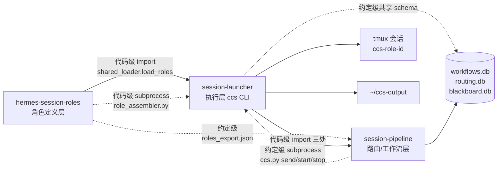
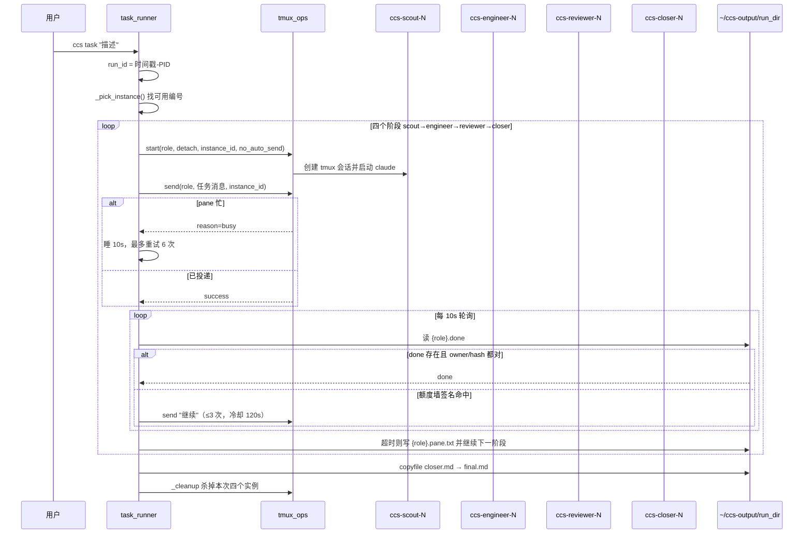
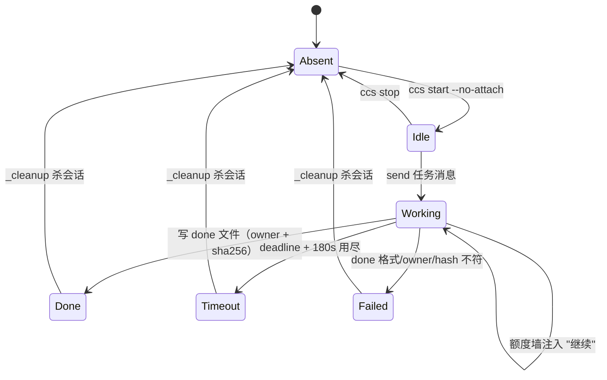

# CCS 当前架构（按代码实测，2026-11-03）

本文描述的是三个仓库在 HEAD 上的实际行为，不是设计意图。凡与代码不符的旧文档，以本文第 7 节的判定为准。

基线：

| 仓库 | 分支 | HEAD |
|---|---|---|
| session-launcher | `r77-routing-daemon-whitelist` | `c399294` |
| session-pipeline | `temp-pr-branch` | `0aed2c3` |
| hermes-session-roles | `main` | `75b087f` |

---

## 1. 一句话定位

`ccs task "任务描述"` 一条命令，让四个角色（scout / engineer / reviewer / closer）各自在独立的 tmux 会话和独立的 claude 进程里接力完成一件工作，产物落到 `~/ccs-output/<时间戳>-<PID>/`。

它替代的手工劳动是：人工开四个窗口、人工把上一阶段的输出粘贴给下一个角色、人工判断"这一步是不是做完了"、人工在角色卡在额度墙上时手动敲"继续"。这些现在都由 `src/task_runner.py` 的轮询循环代做（`task_runner.py:82-138`）。

它**不**做的事：不做多机调度、不做任务队列持久化、不做断点续跑。进程退出即结束，未完成的 run_dir 留在磁盘上不重试。

---

## 2. 三仓库职责边界与依赖方向



实线为进程内 import（缺失时 ImportError，立刻炸），虚线为约定级耦合（格式/路径/子进程，缺失时表现为静默降级或运行期错误）。

### 2.1 hermes-session-roles — 角色定义层

管理：每个角色的 persona JSON（prompt 正文、工具集、`eval_criteria`、produce/consume 标签）、`prompts/base.md` 与 `prompts/roles/*.md` 模板、以及把这些拼装成最终 prompt 的 `role_assembler.py`。

不管理：不启动进程、不写数据库、不知道 tmux 存在。全仓对另外两个仓库**零 import**。

依赖：无。Python 3.10+ 标准库（`README.md:262-265`）。

被依赖：launcher 通过 `sys.path.insert` 后 `from shared_loader import load_roles`（`session-launcher/src/routing/roles.py:52-57`），并通过子进程调 `role_assembler.py`（`roles.py:321-342`）；pipeline 只读导出文件 `~/.hermes/data/roles_export.json`（`session-pipeline/src/routing/router.py:23`），**不 import 本仓代码**。

失败模式：launcher 侧的缺失是硬失败（ImportError）；pipeline 侧的缺失是软失败——导出文件陈旧时路由表静默用旧数据，无告警（`roles/README.md:244-246` 记录 2026-10-22 实测落后 12 个 persona）。

### 2.2 session-launcher — 执行层

管理：CCS 进程生命周期（创建 tmux 会话、启动 claude、注入 workspace CLAUDE.md、写哨兵 JSON、停止、状态查询）、`ccs task` 四阶段流水线、`ccs send` 的消息投递与 gatekeeper 拦截、workflow 客户端（`src/workflow/client.py`）。

不管理：不定义角色内容（向 roles 要）、不决定"哪条 bus 消息该给谁"（那是 pipeline 的事）、不管理 worktree。

依赖：roles 的 `shared_loader` 与 `role_assembler.py`（代码级）；pipeline 的**恰好三个符号**——`p0_exemption`（`ccs.py:557`）、`pipeflow.integrity.CORE_QUESTIONS`（`user_intent_reminder.py:98`）、`template_registry.TemplateRegistry`（`wf.py:245`），以及路径常量 `SESSION_PIPELINE_SRC`（`paths.py:27`）。降级程度不一：`user_intent_reminder.py:93-103` 有 `except Exception` 回退到硬编码文本；`ccs.py:550-563` 只捕获 `PermissionError`，模块缺失会向上抛；`wf.py:241-246` 无 try/except，pipeline 目录缺失时 `wf templates` 直接失败。所以"pipeline 缺失时 launcher 大部分功能仍可用"成立，但 `wf templates` 不在其中。

被依赖：pipeline 通过子进程调用 `ccs.py`（`session-pipeline/src/paths.py:55` 定义 `CCS_CLI`），用于 `send`（`routing_daemon.py:229`、`pipeflow/role_lifecycle.py:884,1113,1144`、`lifecycle/manager.py:515`）、`start`（`role_lifecycle.py:690,756`）、`stop`（`wf_lifecycle.py:1945`）、`status-role`（`routing_daemon.py:175`）。**没有任何 import。**

失败模式：launcher 改 CLI 参数名会让 pipeline 的子进程调用在运行期静默失败（返回码非 0 但不抛异常）。

### 2.3 session-pipeline — 路由与工作流层

管理：bus 消息到角色的路由映射（`routing/router.py`）、自动分发（`routing/auto.py`）、workflow 模板与实例状态机（`pipeflow/`、`lifecycle/`）、常驻守护进程 `routing_daemon.py`。

不管理：不直接创建 CCS（红线 1，`README.md:82`），不定义角色内容，不改 launcher 代码。

依赖：launcher 的 CLI（子进程，约定级）、roles 的导出 JSON（文件，约定级）、共享 SQLite（`~/.hermes/state/workflows.db`、`routing.db`、`~/.hermes/sister_bus/blackboard.db`，约定级 schema）。

被依赖：launcher 的三个 import（见 2.2）。

失败模式：**共享 DB schema 已经漂移**。launcher 的 `src/workflow/schema.py` 定义的 `tasks` 表没有 `template_id` / `p0_state` / `p0_reason` / `p0_marked_at` / `p0_marked_by`，而 pipeline 的 `src/workflow/db.py` 有（后者带 `_migrate_add_column`，`db.py:93-105`）。两边指向同一个 `workflows.db`（launcher `paths.py:35`，pipeline `paths.py:36`，环境变量名不同：`HERMES_WORKFLOWS_DB` vs `SESSION_PIPELINE_WORKFLOWS_DB`）。谁先建库决定表结构，另一方靠 `ALTER TABLE` 补列。

---

## 3. 生产主链路：`ccs task` 的四阶段时序

入口：`ccs task <描述>` → `from task_runner import run_task; sys.exit(run_task(args.description))`（`ccs.py:348-350`）。

### 3.1 总时序



### 3.2 阶段定义与超时

`STAGES` 是唯一的事实来源（`task_runner.py:31-39`），顺序即执行顺序（`ROLES = tuple(STAGES)`，`:40`）：

| 阶段 | 超时默认值 | 环境变量 | 附加指令 |
|---|---|---|---|
| scout | 2400s | `CCS_TASK_SCOUT_TIMEOUT` | 无 |
| engineer | 2400s | `CCS_TASK_ENGINEER_TIMEOUT` | 无 |
| reviewer | 2700s | `CCS_TASK_REVIEWER_TIMEOUT` | "只审查上述产出并给出结论与问题清单，不重写整个实现" |
| closer | 2700s | `CCS_TASK_CLOSER_TIMEOUT` | "把三个阶段的产出整合为一份可直接使用的最终交付文档…" |

四个环境变量在模块导入时读取（`task_runner.py:15-18`），运行中修改无效。宽限期另有 `CCS_TASK_GRACE`，默认 180s（`:21`）。

### 3.3 实例分配：`_pick_instance`

```python
for i in range(1, MAX_INSTANCES):
    if not any(_is_alive(make_tmux_name(role, i)) for role in ROLES):
        return i
return 0
```

（`task_runner.py:43-48`，`MAX_INSTANCES = 16` 见 `tmux_ops.py:65`）

编号 `i` 可用的条件是**四个角色的同号实例全部已死**。只要 `ccs-engineer-3` 还活着，`i=3` 就整号跳过——即使 scout/reviewer/closer 的 3 号都空闲。这条规则保证一个 run 独占一整列编号，`_cleanup` 只需按列杀。

返回 0 表示 1..15 全被占。此时 `run_task` 直接打印"无空闲任务实例"并 `return 1`（`task_runner.py:225-228`），不会退化到常驻角色上跑。`_deliver` 里另有一道 `instance_id <= 0` 的拒绝（`:55-56`），是第二层保险。

`_is_alive` 在 tmux 探测超时时返回 **True**（`tmux_ops.py:209-228`）——探测失败按"占用"处理，宁可跳过编号也不误杀。这是有意的 fail-closed 方向。

### 3.4 消息投递：`_deliver`

`start(role, detach=True, instance_id=i, no_auto_send=True)` 后立即 `send`（`task_runner.py:63-71`）。忙则重试，`BUSY_RETRIES = 6`、`BUSY_INTERVAL = 10`（`:22-23`），总计最多 7 次尝试、约 60s 等待。**只在 `attempt < BUSY_RETRIES` 时 sleep**（`:69-70`），最后一次失败不空等。

非 busy 的失败（角色不在注册表、会话不存在等）立即返回失败，不重试。

### 3.5 完成检测：`_wait_stage`

`done` 文件路径 `{run_dir}/{role}.done`，产物 `{run_dir}/{role}.md`（`task_runner.py:84-86`）。每 `POLL_INTERVAL = 10` 秒读一次（`:24`）。

校验链（`:99-111`），任何一环失败都返回 `"failed"`，不重试：

1. `done` 文件存在且非空；
2. `parts = f.read().split()` 恰好 **2** 个字段（`len(parts) != 2` → failed）；
3. `owner` 等于本阶段期望的实例名（例如 `ccs-scout-3`）；
4. 产物文件存在且非空；
5. `sha256(产物) == claimed`。

契约文本由 `_contract()` 生成（`:141-151`），给角色的原话就是这一行命令：

```
{owner} $(sha256sum {md} | cut -d' ' -f1)
```

**为什么绑 hash 而不是匹配关键词**：早期实现靠扫描 pane 内容判断"角色说完成了"，结果把上一轮的陈旧 pane 文本误判成本轮完成。改成"角色必须自己算出产物 hash 写进 done 文件"后，只有真正读得到产物文件、且文件内容与声明一致，才算完成。owner 字段则防止上一个阶段的 done 文件被当成这一阶段的。

超时处理（`:124-138`）：`deadline = 起点 + timeout_sec`，到点后进入 180s 宽限（`GRACE_INTERVAL`），宽限期内仍然每 10s 轮询一次。宽限结束仍未完成 → 抓 pane 尾部 50 行写入 `{role}.pane.txt` 供事后排查，返回 `"timeout"`。

`"timeout"` **不中断流水线**：`_run_stages` 把它记进 `prior` 后继续下一阶段（`task_runner.py:188-215`），全部阶段跑完后如果最后状态是 timeout 才返回 1。所以 reviewer 超时，closer 仍会拿到 scout/engineer 的产物继续干活。而 `"failed"`（契约违约）会立即 `return 1` 终止。

### 3.6 额度墙自愈

```python
CONTINUE_SIGNATURES = ("FreeUsageLimitError", "usage limit reached", "503")   # :26
CONTINUE_INJECTS = 3                                                          # :27
CONTINUE_COOLDOWN = 120                                                       # :28
```

在 done 判定之后、同一轮询循环内执行（`task_runner.py:112-123`）：抓 pane 尾部 15 行，命中任一签名就向该角色 `send(role, "继续", ...)`。三重封顶：每阶段最多 3 次注入、两次注入间隔 ≥120s、只有 pane 签名命中才注入。不改 deadline，不改任何判定。

"503" 是宽签名，理论上可能把正常的服务端错误误判成额度墙，最多触发 3 次注入，代价可接受（`observer-log.md:89` 记录了这条已接受风险）。

### 3.7 收尾

四阶段全部 `done` 后 `shutil.copyfile(closer.md, final.md)`（`task_runner.py:170-174`）。注释说明了为什么是 copy 不是 rename：`closer.done` 里的 SHA256 指向 `closer.md`，改名会让契约失效。

`finally` 块调用 `_cleanup(list(names.values()))`（`:230-234`），只杀本次 run 的四个实例，不碰常驻实例、不碰别的编号。

---

## 4. 角色实例与状态机

tmux 会话名由 `make_tmux_name(role, instance_id)` 决定（`tmux_ops.py:68-76`）：

- `instance_id == 0` → `ccs-<role>`（常驻实例）
- `instance_id > 0` → `ccs-<role>-<id>`

`MAX_INSTANCES = 16`（`tmux_ops.py:65`）是编号上限，`_pick_instance` 只遍历 1..15。



注意 `Timeout` 与 `Failed` 的区别：`Timeout` 只影响退出码，`Failed` 直接终止流水线。两者最终都走 `_cleanup`。

实例的 workspace 在 `~/ccs-workspaces/<role>/instances/<id>`（`core.py:486-516`），其中 `CLAUDE.md` 由 `_write_instance_claude_md` 写入（`core.py:1348-1366`），角色知识由 `inject_role_knowledge_into_workspace` 注入（`roles.py:420-552`）。

哨兵文件按实例分文件：`instance_id == 0` → `{role}.json`，`> 0` → `{role}-{id}.json`，目录 `~/.hermes/run/ccs-sentinels`（`ops/sentinel.py:46,216-223`）。

**关于收缩宪法的四角色白名单**：`scout / engineer / reviewer / closer` 这个白名单是**文档级规则，代码里没有强制**。全仓 grep `whitelist|WHITELIST|白名单` 只命中三处无关的：`core.py:180` 的 `_AUTOMATED_SOURCES`、`core.py:280-281` 的权限 allowlist、`codex_ops.py:72,82` 的 role_name 检查。角色注册校验走的是 persona JSON 的 `name` 字段（`ops/validators.py:17-29`），只要角色在注册表里就能 `ccs start`。因此"不许启动白名单外角色"目前靠人遵守，不靠代码拦截。

---

## 5. 关键文件与数据契约

| 路径 | 生产者 | 消费者 | 格式 | 生命周期 |
|---|---|---|---|---|
| `~/ccs-output/<YYYYmmdd-HHMMSS>-<PID>/` | `task_runner.run_task`（`:219-222`） | 人、closer 阶段 | 目录 | 永久保留，无清理逻辑 |
| `{run_dir}/{role}.md` | 各阶段角色 | 下一阶段角色、`_publish_final` | Markdown | 同 run_dir |
| `{run_dir}/{role}.done` | 各阶段角色 | `_wait_stage`（`:95-115`） | 两个空白分隔字段：`<实例名> <64位小写hex sha256>` | 同 run_dir，读后不删 |
| `{run_dir}/{role}.pane.txt` | `_wait_stage` 超时分支（`:126-131`） | 人 | tmux pane 尾部 50 行纯文本 | 仅超时时生成 |
| `{run_dir}/final.md` | `_publish_final`（`:170-174`） | 人 | Markdown，`closer.md` 的副本 | 仅在四阶段全 done 时生成 |
| `~/.hermes/run/ccs-sentinels/<role>[-<id>].json` | `ops/sentinel.write_sentinel`（`:216-223`） | `ccs status`、pipeline 存活监控 | JSON | 会话存活期 |
| `~/.hermes/run/ccs-health/` | `routing/survival_monitor.py`（`:26-30,442`） | 健康检查 | JSON | 滚动覆盖 |
| `~/session-launcher/ccs_config.json` | 人工编辑 | `ops/ccs_config.py`（`:14`） | JSON：`version` / `auto_send.enabled` / `interval_sec` / `default` / `roles` | 长期；可用 `CCS_CONFIG_PATH` 覆盖 |
| `~/.hermes/data/roles_export.json` | 手动跑 `shared_loader.py --export` | `routing/router.py:23` | JSON | 手动刷新，无 daemon |
| `~/.hermes/state/workflows.db` | launcher `workflow/schema.py`、pipeline `workflow/db.py` | 两侧 | SQLite WAL | 长期；**两侧 schema 不一致，见 2.3** |
| `~/.hermes/state/routing.db` | pipeline `routing/rdb.py`（`:52-74`） | pipeline | SQLite：`routing(role PK, produce, consume, updated_at, updated_by)` + `routing_audit` | 长期 |
| `~/.hermes/sister_bus/blackboard.db` | 各 session、`bus_client.py` | 各 session、`routing_daemon`、`drift_detector` | SQLite FTS5 | 长期 |
| `~/.hermes/workflows/*.json` | 人工/模板注册表 | `pipeflow/engine.py`、`template_registry.py` | JSON | 长期 |

契约要点：

- done 文件**读后不删**。同一次 run 里重复读同一文件不会产生副作用，但如果角色写错后重写，`_wait_stage` 下一次轮询就会读到新内容——契约校验是无状态的。
- `run_dir` 用 PID 而不是随机串（`task_runner.py:219`），同一秒内并发两次 `ccs task` 靠 PID 区分。极端情况下 PID 复用 + 同秒启动会撞名，`os.makedirs(..., exist_ok=True)` 会静默复用目录——未验证实际是否发生过。
- `final.md` 与 `closer.md` 内容相同但 inode 不同。下游如果按 mtime 判断新鲜度，注意 copy 会更新 mtime。

---

## 6. 实验区与生产链路的隔离

`/home/administrator/ccs-role-lab` 是角色提示词的对照实验场，**不在生产链路里**。生产链路的任何代码不 import 它，它也不 import 生产代码（`runner/runner.py` 只用标准库，`observer-log.md:93`）。

它做什么：把"候选角色提示词"和"基线提示词"跑在同一批代码审查案例上，用词面匹配打分（`TEXT_WEIGHT=0.7` / `LINE_WEIGHT=0.3`，`runner.py` 常量区），比较通过率。案例来源是从三个生产仓库里挑真实的历史缺陷（`cases/*/source.json` 记录 `repo` / `file` / `source_commit`），把代码片段抽出来做成盲测输入。

与生产仓库的关系：**只读引用**。`source.json` 里的 `repo`/`file`/`source_commit` 是溯源信息，`runner.py` 不会去读生产仓库的当前文件——它读的是 `cases/*/input` 里冻结的代码片段。所以生产代码继续演进不会影响历史案例。

为什么隔离是强制的（`constitution.md` 八条）：

- 第 2 条：优化者只能看 dev 集，不能看 holdout；评测器源码与 holdout 答案对优化者不可见。理由很直接——如果候选能读到答案，实验就退化成记忆测试。
- 第 4 条：候选不能修改评测器、数据集、答案、模型配置、统计口径。改动资产必须升版本，且作废之前的所有比较。理由：跨版本比通过率等于把两个不同的尺子读数相减。
- 第 6 条：任何角色不经 F01/P01 门禁不得进生产 CCS；生产仓库与实验室互相隔离。
- 第 8 条：输入不得包含 `.git`、修复 diff、源码提交信息、答案路径。任何一条泄漏都等于把答案塞进题面。

违反第 2-6 条直接作废实验。

冻结集与开发集：

- dev 集（缺陷 6 例 + clean 2 例）对优化者可见，用于迭代提示词。
- holdout 集（缺陷 6 例 + clean 2 例）只用于最终评分，优化者不可见。
- 划分在 `manifests/dataset-pilot.json` 里按 `(repo|path|commit)` 的哈希随机分配，每例带 `expected.json` / `input` / `source.json` / `task.md` 四个 sha256。
- `runner.py:80-89` 的 `check_split_path` 在代码层面双向强制：holdout 结果只能写 `results/holdout/`，dev 结果禁止写入该目录。
- `runner.py:72-77` 的 `check_lab_path` 拒绝任何写到实验室目录之外的路径。

生产侧完全没有这套东西：`ccs task` 不做 A/B、不记分、不冻结案例。两者唯一的交集是"角色提示词"这个输入格式。

---

## 7. 文档生死地图

判据只有一条：文档描述的系统与当前代码、以及收缩宪法（`session-launcher/CLAUDE.md` 顶部，四角色白名单 + 唯一验收路径 `ccs task`）是否一致。

### 7.1 session-launcher

| 文件 | 行数 | 判定 | 理由 | 建议 |
|---|---|---|---|---|
| `CLAUDE.md` | 60 | 有效 | 顶部即收缩宪法；其余章节与 `ccs.py` 子命令、`paths.py` 一致 | 保留 |
| `AGENTS.md` | 111 | 部分过期 | 未提及收缩宪法与 `ccs task` 主链路 | 改写 |
| `README.md` | 328 | 部分过期 | 详述启动参数与重启流程（准确），但完全没提宪法规定的唯一验收路径 `ccs task` | 改写 |
| `PUBLIC_API.md` | 78 | 部分过期 | `:43-45` 声称"2026-10-30 实测 20 个"子命令，但那 20 个里**没有 `task`**（`ccs.py:142` 的 `p_task`）；`reap` 有、`task` 漏。wf 子命令表（`:47-48`）准确 | 改写 |
| `ISSUES.md` | 19 | 有效 | 短，无过时架构断言 | 保留 |
| `HERMES_SESSION_ARCHITECTURE.md` | 236 | 部分过期 | 2026-07 的 V2 设计稿，但 2026-10-22 已按代码逐条加校正：`:176` 注明 tracker"现网不触发"、`:213` 注明"现网零实例"、`:128` 注明 `--feed-cat` 已删、`:197-198` 注明 feed push 未实现。设计意图与实测混排，读者须逐行分辨 | 保留（作为设计史） |
| `BUS_PUSH_ARCH.md` | 56 | 有效 | 描述 bus 推送格式，与 `bus_client.py` 一致 | 保留 |
| `docs/TECHNICAL_DEEP_DIVE.md` | 167 | 部分过期 | 主体准确（模块树、core.py 分工、tmux 忙判据），但 `:40-42` 的顶层子命令清单是 19 个、缺 `task` 与 `reap` | 改写 |
| `docs/approval_token_design.md` | 54 | 有效 | 2026-10-22 已按实测重写为 ADR：正文明确标注"已全部退场"，470/41 那组数字被限定为"通道活着时的证据"，并列出三个删除提交（pipeline `841e545`/`e2521ce`/`2a8a016`、launcher `32568d7`），与 `manager.py:409-412` 一致 | 保留 |
| `docs/workflow_architecture_fix.md` | 235 | 已失效 | 描述的 `handoff_status` / `verification_rules` 两个字段在 launcher 与 pipeline 全仓 grep 均无命中，从未实现 | 归档 |

### 7.2 session-pipeline

| 文件 | 行数 | 判定 | 理由 | 建议 |
|---|---|---|---|---|
| `CLAUDE.md` | 198 | 有效 | 与 `paths.py`、`routing_daemon.py` 的间隔常量一致 | 保留 |
| `AGENTS.md` | 133 | 有效 | 头部日期 2026-07-24，但正文已校正：`:13` 写明跨项目只走 `ccs.py {send,start,stop,status-role}` 子进程，`:16` 明确"不是三层流水线"、路由数据来自 `roles_export.json`。日期旧不等于内容旧 | 保留 |
| `README.md` | 87 | 有效 | 明写"并行消费，不是三层流水线"（`:9`），与代码一致 | 保留 |
| `PUBLIC_API.md` | 91 | 有效 | 与 CLI 一致 | 保留 |
| `ISSUES.md` | 25 | 有效 | 短 | 保留 |
| `CHANGES.md` | 277 | 有效 | 带日期的变更日志，作为历史记录成立 | 保留 |
| `docs/DOCS.md` | 41 | 有效 | 索引 | 保留 |
| `docs/SYSTEM_LANDSCAPE.md` | 104 | 有效 | 与当前分层一致 | 保留 |
| `docs/ARCHITECTURE.md` | 154 | 有效 | 与 `pipeflow/` + `lifecycle/` 结构一致 | 保留 |
| `docs/ADR-APPROVAL-AUTHORITY.md` | 94 | 有效 | ADR 记录"密钥退场"的决策，与代码一致 | 保留 |
| `docs/WORKFLOW_TEMPLATE_SPEC.md` | 282 | 有效 | 2026-10-22 重写；必填字段与 `template_registry.REQUIRED_META`（`:61-64`）一致，且明确写"模板总数用 `select count(*)`"而不写死（`:92`），并标注 `validate-all` rc=0 不能当 CI 门禁（`:198`） | 保留 |
| `docs/TEST_WORKFLOW.md` | 69 | 有效 | 测试流程 | 保留 |
| `docs/collab-modes-implementation.md` | 75 | 有效 | 与 `config_loader.py` 的协作模式配置一致 | 保留 |
| `docs/TECHNICAL_DEEP_DIVE.md` | 115 | 有效 | 2026-10-22 按代码重写；`:9` 明确 roles 是两个消费者而非流水线第一级，`:41-44` 的模板统计带复算方法与"别当不变量"警告 | 保留 |

### 7.3 hermes-session-roles

| 文件 | 行数 | 判定 | 理由 | 建议 |
|---|---|---|---|---|
| `CLAUDE.md` | 86 | 有效 | 与 `shared_loader.py` / `role_assembler.py` 一致 | 保留 |
| `AGENTS.md` | 173 | 部分过期 | `:15` 已明确"不是三层流水线"，但全文未提收缩宪法的四角色白名单与 `ccs task` 主链路 | 改写 |
| `README.md` | 275 | 有效 | 角色表与 `eval_criteria` 说明准确（含 `CRITERIA_WINDOW=3` 实测） | 保留 |
| `ARCHITECTURE.md` | 48 | 有效 | 短，与代码一致 | 保留 |
| `PUBLIC_API.md` | 56 | 有效 | 与 `shared_loader` API 一致 | 保留 |
| `ISSUES.md` | 130 | 有效 | 问题清单，非架构断言 | 保留 |
| `docs/ECOSYSTEM_OVERVIEW.md` | 172 | 部分过期 | `:16` 与 `:78-79` 把 watchdog / tracker / `routing/partner.py` 写成常态能力，但 tracker 只在 `bus_track and partners` 时启动（`core.py:862-866`），`--partner` 已在 `ccs.py:35,46` 标注废弃；`:135` 说"V2.0 全部从 tmux 实时派生"，同句又说状态落两份文件——实际 `list_sentinels` 是"文件 + tmux 合并，活 PID 优先"（`ops/sentinel.py:321-344`）。其余章节（数据流、pull 而非 push、故障排查表）与代码一致 | 改写 |
| `docs/ARCHITECTURE.md` | 186 | 有效 | 与代码一致 | 保留 |
| `docs/INDEX.md` | 49 | 有效 | 索引 | 保留 |
| `docs/QUICKSTART.md` | 52 | 有效 | 快速上手 | 保留 |
| `docs/PROMPT_STANDARD.md` | 85 | 有效 | prompt 编写规范 | 保留 |
| `docs/ROLE_TEMPLATE.md` | 88 | 有效 | 模板说明 | 保留 |
| `docs/TECHNICAL_DEEP_DIVE.md` | 175 | 部分过期 | `:8` 仍把关系画成 `session-roles → launcher → pipeline` 的单向链，与实际"roles 被两方并行消费"（本仓 `AGENTS.md:15`、`session-pipeline/README.md:9`）冲突；其余章节（数据模型、`VALID_DRIVES`、19 个角色计数）准确 | 改写 |
| `docs/CLAUDE_CODE_REFERENCE.md` | 372 | 有效 | 外部工具的参考资料，不随本项目演进失效 | 保留 |
| `docs/TEST_WORKFLOW.md` | 91 | 有效 | 测试流程 | 保留 |
| `docs/rfc-adopt-claude-code-features.md` | 275 | 有效 | 头部 `:3` 明标"状态: 草案"，正文是方案讨论而非现状断言，不会被误读成已实现能力 | 保留 |
| `prompts/base.md` | 273 | 有效 | 运行时真正加载的基线 prompt | 保留 |
| `prompts/roles/*.md`（18 个，46-68 行） | — | 有效 | 角色 prompt 正文 | 保留 |

统计：共判定 42 行（launcher 10 + pipeline 14 + roles 18）。

- **已失效 1 个**：`session-launcher/docs/workflow_architecture_fix.md`。它描述的 `handoff_status` / `verification_rules` 在两个仓库全仓 grep 均无命中（唯一命中就是本文与该文档自身），从未实现。
- **自相矛盾 0 个**。
- **部分过期 8 个**：`session-launcher/AGENTS.md`、`session-launcher/README.md`、`session-launcher/PUBLIC_API.md`、`session-launcher/HERMES_SESSION_ARCHITECTURE.md`、`session-launcher/docs/TECHNICAL_DEEP_DIVE.md`、`hermes-session-roles/AGENTS.md`、`hermes-session-roles/docs/ECOSYSTEM_OVERVIEW.md`、`hermes-session-roles/docs/TECHNICAL_DEEP_DIVE.md`。
- **有效 33 个**。

三个 `CLAUDE.md` 全部判为有效：launcher 的顶部就是收缩宪法本身，pipeline 与 roles 的与各自代码一致。`AGENTS.md` 三个中两个判为部分过期，共同原因是它们没写收缩宪法后的四角色白名单与 `ccs task` 主链路。

部分过期里有 3 个的共同病因是**子命令清单漏了 `task`**：`PUBLIC_API.md:43-45`、`docs/TECHNICAL_DEEP_DIVE.md:40-42`、`README.md` 全篇。`ccs.py:142` 注册了 `p_task`，所以这不是文档版本问题，而是这几份文档在 `task` 子命令加入后没有回头补。

---

## 8. 已知风险与文档债

以下每条都是读代码时实际看到的，不是推测。

**R1 收缩宪法没有代码强制。** 四角色白名单只存在于 `session-launcher/CLAUDE.md` 顶部。`ccs start <任意注册角色>` 都能成功，校验只看 persona JSON 的 `name` 字段（`ops/validators.py:17-29`）。风险：宪法与运行时行为之间没有任何守卫，靠人记。

**R2 两个仓库各写一份 `workflows.db` schema，已经漂移。** launcher `src/workflow/schema.py` 的 `tasks` 表缺 `template_id` / `p0_*` 五列；pipeline `src/workflow/db.py` 有，并带迁移函数（`:93-105`）。谁先建库谁定结构。风险：launcher 独跑建库后，pipeline 读到缺列表会走 `ALTER TABLE` 补列；反向场景（pipeline 先建、launcher 读）没有对应迁移，`INSERT` 列数不匹配会报错。未验证反向场景是否真的会崩——需要实际建库验证。

**R3 `roles_export.json` 靠手动刷新。** 没有任何 daemon 跑 `shared_loader.py --export`（`hermes-session-roles/README.md:244-246`）。风险：改了 persona 的 produce/consume 但忘了导出，pipeline 路由表就是旧的，且无告警。

**R4 `_is_alive` 探测超时按"活着"处理。** `tmux_ops.py:209-228` 在 `TimeoutExpired` 时返回 True。风险：tmux server 整体卡死时，`_pick_instance` 认为所有编号都占用，`ccs task` 打印"无空闲任务实例"并退出（`task_runner.py:226-228`）。这是有意的保守方向，但症状（"实例耗尽"）与真实原因（tmux 卡死）不一致，排查时容易走偏。

**R5 文档里的 `ccs task` 缺失。** `session-launcher/README.md` 328 行，讲透了启动参数、重启序列、环境变量，但没提宪法规定的唯一验收路径 `ccs task`。新人按 README 走不会发现这条链路。

**R6 审批密钥的统计数字有被断章取义的风险。** `docs/approval_token_design.md` 第 11-12 行那张表里的 470/41 是"通道活着时"的读数，正文 `:31-33` 才说"已全部退场"。只看表格不看下文的人会以为密钥还在跑。文档本身没错，但表与结论隔了 19 行，排版上容易误读。

**R7 `workflow_architecture_fix.md` 描述从未落地的字段。** `handoff_status` 与 `verification_rules` 在两个仓库都没有命中。风险：读者按此文找代码会找不到。

**R8 实例编号上限与 `_pick_instance` 的边界不一致。** `MAX_INSTANCES = 16`，`range(1, MAX_INSTANCES)` 只到 15。第 16 号永远不会被分配。影响很小（15 列并发已远超实际用量），但常量名与行为差一。

**R9 `final.md` 用 copy 而非 move，mtime 会变。** `task_runner.py:170-174`。下游若按 mtime 判断"这份交付是不是最新的"，copy 会把它标成最新——这通常正是想要的，但 `closer.md` 与 `final.md` 内容相同、时间不同，容易被误认为两次产出。

**R10 run_dir 撞名。** `run_id` 用 `时间戳-PID`（`task_runner.py:219`），同秒同 PID 会复用目录（`exist_ok=True`）。实际发生概率极低，未验证是否出现过。

**R11 `ECOSYSTEM_OVERVIEW.md` 把"实时派生"与"落盘哨兵"写在同一句里。** `:135` 前半说"V2.0 全部从 tmux sessions + 角色 JSON 实时派生"，后半立刻说"状态落 `ccs-sentinels/{role}.json` 与 `ccs-health/{role}.json` 两处"。代码是第三种：`list_sentinels` 先读文件再读 tmux，**活 PID 优先**（`ops/sentinel.py:321-344`）。"实时派生"和"落盘"都不完整，真正的规则是合并去重。

---

## 附：本文的验证方式

所有行为断言均来自直接阅读源码，行号以 HEAD 为准。图用 Mermaid `flowchart` / `sequenceDiagram` / `stateDiagram-v2`，节点 ID 全为 ASCII。凡未实际运行验证的（R2 反向建库、R10 撞名），文中已标"未验证"。
